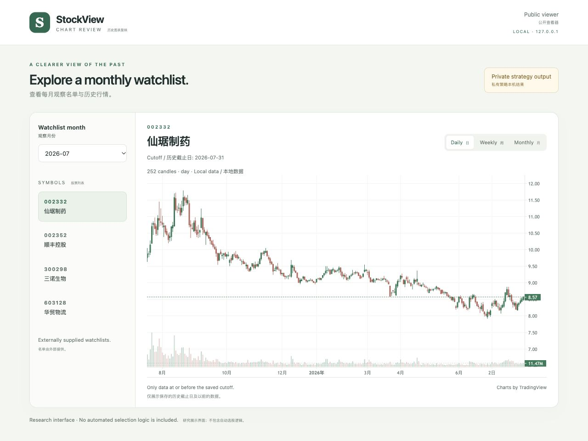
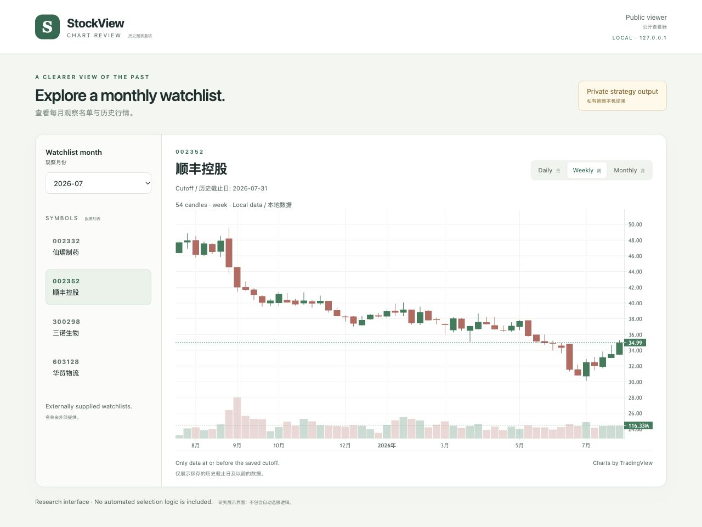

# StockView · Chart Review

**A local candlestick viewer for monthly watchlists.**

<sub>面向月度观察名单的本地 K 线查看器。</sub>


Review daily, weekly and monthly price charts from local CSV files. Watchlists are supplied manually or by an authorized private engine, and each chart respects a saved historical cutoff. The included demo uses entirely fictional prices.

<sub>从本地 CSV 查看日、周、月 K 线；名单由手动提供或授权私有引擎生成，图表按保存的历史截止日截取。演示行情完全虚构。</sub>

## Strategy privacy

The underlying trading strategy was contributed by another person. To protect their privacy and confidential work, its specific rules and implementation cannot be disclosed publicly. The core strategy, parameters, configuration and research code are stored in [StockView-private](https://github.com/LarrryLiu/StockView-private), which requires explicitly granted access.

<sub>底层交易策略来自他人的贡献。为保护其隐私和非公开研究，具体策略规则及实现不对外开放；核心策略、参数、配置和研究代码保存在需要授权访问的私有仓库中。</sub>

This public repository primarily demonstrates the application framework, chart interface and generic data handling. It does not include the core strategy. When strategy computation is needed, the launcher delegates it to the private repository's local entry point; the public framework contains no replacement strategy or embedded private parameters.

<sub>本公开仓库主要展示应用框架、图表界面和通用数据处理，不包含核心策略。需要策略计算时，启动程序调用私有仓库本地副本的入口，公开框架中不内置替代策略或私有参数。</sub>

The default demo works independently with fictional data. Private mode requires an authorized local checkout and its dependencies. GitHub provides source access; it is not a hosted strategy API, and the browser never receives repository credentials or strategy source.

<sub>默认虚构演示可独立运行。私有策略模式需要先取得权限、克隆私有仓库并安装依赖；GitHub 提供的是代码访问，不是在线策略接口，浏览器不会收到仓库凭据或策略源代码。</sub>

## Historical result screenshots

These screenshots show actual saved selections at the **31 July 2026** cutoff, displayed through the public framework in authorized private mode. They are interface examples, not profit claims. Only watchlist names and price charts are shown; strategy rules, parameters and scores are omitted. For readability, the local screenshot export retains the last 252 available daily bars per symbol. Prices are shown as supplied, without viewer-side corporate-action adjustments.

<sub>两张截图展示截至 2026 年 7 月 31 日的真实已保存筛选结果，由授权私有模式下的公开框架呈现。它们用于展示界面，不代表收益证明；仅显示名单与行情，不显示规则、参数或评分。截图使用每只股票最后 252 条可用日线，查看器本身不复权。</sub>

**Daily result view / 日线结果展示**



**Weekly result view / 周线结果展示**



## Annual portfolio backtest

**Reconstructed research simulation — not live or audited performance.** These results were recalculated from the saved historical selection lists using a daily, self-financing, long-only portfolio. They do not reuse the legacy per-stock scenario-return fields. All years, including losses, are shown.

<sub>以下为重建的研究模拟，不是实盘或审计业绩。结果基于已保存的历史名单，以每日资金与持仓账本重新计算，不使用旧版个股情景收益字段；盈利和亏损年份均完整列示。</sub>

| Year | Observed period | Winning / closed trades | Trade win rate | Net portfolio return | Within-year max drawdown |
| --- | --- | ---: | ---: | ---: | ---: |
| 2020 (partial) | 2020-02-03 – 2020-12-31 | 57 / 83 | 68.67% | +32.37% | -11.29% |
| 2021 | 2021-01-04 – 2021-12-31 | 59 / 122 | 48.36% | +4.68% | -11.44% |
| 2022 | 2022-01-04 – 2022-12-30 | 50 / 92 | 54.35% | -1.14% | -22.42% |
| 2023 | 2023-01-03 – 2023-12-29 | 63 / 120 | 52.50% | +7.07% | -10.77% |
| 2024 | 2024-01-02 – 2024-12-31 | 41 / 101 | 40.59% | -20.45% | -24.95% |
| 2025 | 2025-01-02 – 2025-12-31 | 43 / 73 | 58.90% | +18.69% | -11.28% |
| 2026 (partial) | 2026-01-05 – 2026-08-05 | 29 / 78 | 37.18% | -11.05% | -20.82% |

<sub>“净组合收益率”由年末净值相对上年末净值计算；首年相对初始资金计算。2020 年从 2 月 3 日开始，2026 年截至 8 月 5 日，均为不完整年度，不做年化。胜率为该年平仓且扣除模拟成本后盈利的交易数／该年全部平仓交易数；未平仓交易不计入胜率。</sub>

The run starts with **CNY 1,000,000**, covers **673 saved stock-month selections** across **79 signal months**, and records **669 closed trades** plus **4 positions still open** at the end. Daily equity includes marked-to-market open positions and idle cash. No terminal liquidation or future exit proceeds are assumed. A win rate above 50% can coexist with a negative portfolio return because trade sizes and loss magnitudes differ.

<sub>初始资金为人民币 100 万元，使用 79 个信号月份、673 条股票—月份记录；共 669 笔平仓交易，期末仍有 4 笔持仓。净值包含未平仓持仓的期末估值及闲置现金，不虚构期末清仓或未来卖出所得。交易金额及盈亏幅度不同，因此胜率超过 50% 也可能产生组合亏损。</sub>

**Execution assumptions.** Saved month-end signals are acted on at the next available market-session open. New allocations are equal-weighted across the available cash budget; exits use the private policy or the next monthly rebalance. The simulator respects T+1, skips unavailable or one-price limit-up entries, defers unavailable/locked-down sales, and retains cash when there is no selection. Modeled costs are 0.30% adverse slippage and 0.025% commission per side, plus sell-side stamp-duty assumptions of 0.10% before 28 August 2023 and 0.05% thereafter. Fractional sizing is used; minimum commissions, board lots, transfer fees, queue priority and market impact are not modeled.

<sub>执行口径：月末信号在下一可用交易日开盘执行，按可用现金等权分配，由私有退出规则或下一月调仓退出；考虑 T+1、无法交易及一字涨停无法买入，卖出受阻时延后，无名单时保留现金。双边各计 0.30% 不利滑点及 0.025% 佣金，卖出印花税模拟值在 2023 年 8 月 28 日前为 0.10%，之后为 0.05%。采用可分割持仓，未模拟最低佣金、整手限制、过户费、排队成交和市场冲击。</sub>

**Material limitations.** This is an in-sample reconstruction from saved signals, not an independent out-of-sample test or proof of profitability. Historical security/ST/delisting metadata and adjustment factors are not fully verified; corporate-action factors are reconstructed from the source price series. Daily bars approximate intraday limit-order fills. Two malformed source rows were quarantined; 19 portfolio valuation dates carry one position at its last valid price. These gaps can affect returns and drawdowns. The two chart screenshots above use source OHLC; the portfolio calculation uses its reconstructed adjusted-price basis. Detailed strategy rules and the calculation code remain private; only the authorized screenshots and annual aggregates are published.

<sub>重要限制：这是基于已有信号的样本内重建，非独立样本外检验，也不证明策略盈利。历史证券、ST、退市信息及复权因子尚未完全核验，复权因子由原始价格序列推算，日线仅近似盘中限价单成交。两条无效数据行已隔离，19 个组合估值日有一笔持仓沿用上次有效价格，可能影响收益及回撤。上方截图使用源 OHLC，组合计算使用重建的复权价格口径；策略规则及计算代码保持私有，仅公开经授权的截图和年度汇总。</sub>

The exact displayed aggregates are also available in [performance-summary.json](docs/performance-summary.json).

<sub>表格对应的精确汇总数值见上面的 JSON 文件。</sub>

## Features

- **Daily, weekly and monthly candles** with volume and interactive zoom. <br><sub>日／周／月 K 线、成交量及交互缩放。</sub>
- **Monthly manual watchlists** with a separate cutoff per symbol. <br><sub>按月份手动维护名单，并为每只股票保存历史截止日。</sub>
- **Local processing** with no market-data API key or external chart scripts. <br><sub>本地处理，无需行情 API 密钥，图表脚本随仓库提供。</sub>
- **English-first interface and documentation**, with smaller Chinese notes. <br><sub>界面及文档以英文为主，中文说明使用较小字号。</sub>

## Quick start

Use Python 3.11 or later. Run the following commands from a terminal. Initial dependency installation requires an internet connection; the fictional demo then runs locally.

<sub>需要 Python 3.11 或更高版本。首次安装依赖需要联网，之后虚构数据演示在本地运行。</sub>

```bash
git clone https://github.com/LarrryLiu/StockView.git
cd StockView
python3 -m venv .venv
source .venv/bin/activate
python -m pip install -r requirements.txt
python scripts/create_sample_data.py
python launch.py
```

Open **http://127.0.0.1:5051/** if the browser does not open automatically. Press `Ctrl+C` to stop. If port 5051 is already in use, close the other local viewer first.

<sub>浏览器未自动打开时，访问上面的本机地址；按 `Ctrl+C` 停止。端口已被占用时，先关闭其他本地查看器。</sub>

On Windows PowerShell, use `python` instead of `python3`, and activate the environment with `.\.venv\Scripts\Activate.ps1`.

<sub>Windows PowerShell 中将 `python3` 替换为 `python`，并使用上述 Windows 路径激活环境。本次未进行 Windows 实机验证。</sub>

## Authorized private strategy mode

After obtaining access, clone the private repository alongside this project and install its dependencies into the same Python environment. Replace the configuration and input paths below with your authorized local files. No credentials belong in command arguments or public configuration files.

<sub>获得授权后，将私有仓库克隆到本项目旁边，并在同一 Python 环境安装依赖。请将下面的配置及数据路径替换为你已获授权的本地文件；不要把凭据写入命令参数或公开配置。</sub>

```bash
git clone https://github.com/LarrryLiu/StockView-private.git ../StockView-private
python -m pip install -r ../StockView-private/requirements.txt
python launch.py --private-root ../StockView-private --private-config /path/to/private-config.yaml --private-input /path/to/private-data
```

`launch.py` calls `viewer_bridge.py` inside the private checkout using a local subprocess. That private entry point owns all strategy computation and returns only watchlists and daily chart data. Generated files remain under the private checkout's Git-ignored `.viewer-exports/` directory. The tracked public `picks.json` and demo CSVs are not overwritten. If private access, configuration or computation fails, private mode stops instead of silently displaying the demo.

<sub>启动程序通过本机子进程调用私有副本中的入口，全部策略计算由该入口完成，仅返回名单和日线图表数据。生成文件保存在私有副本中被 Git 忽略的目录，不覆盖公开名单或演示数据；缺少权限、配置或计算失败时停止启动，不会悄悄切换到演示。</sub>

The viewer stays on loopback. Authorized private results are visible locally; the runtime does not automatically upload results or create a public strategy endpoint.

<sub>查看器仍仅监听本机，授权后的私有结果仅供本地查看；此运行流程不自动上传结果，也不建立公开策略接口。</sub>

## Your own watchlist

1. Place one CSV per symbol in `collected_stocks/`. See the [data format](docs/DATA_FORMAT.md).
2. Edit `picks.json` with the desired month, symbol, display name and cutoff.
3. Refresh the page. No screening or ranking is performed.

<sub>每只股票放一份 CSV，然后修改观察名单文件并刷新页面。公开版不进行自动筛选或排名。仓库忽略本地 CSV；也不要把私有策略的真实名单提交到公开仓库。</sub>

```json
{
  "2025-12": [
    {"symbol": "DEMO_A", "name": "Fictional Alpha", "cutoff": "2025-12-31"}
  ]
}
```

```text
Manual watchlists / authorized private-engine results
                         |
                  Local chart framework
                         |
               Saved historical cutoff
                         |
             Daily / weekly / monthly charts
```

## Project layout

| Path | Purpose |
| --- | --- |
| `launch.py` | Optional delegation to an authorized private checkout. <br><sub>按需调用已授权的私有副本。</sub> |
| `viewer.py` | CSV loading, cutoff handling and read-only chart endpoints. <br><sub>通用 CSV 加载、历史截取与只读图表接口。</sub> |
| `index.html`, `assets/` | Bilingual chart interface. <br><sub>双语图表界面。</sub> |
| `picks.json` | Manually supplied fictional watchlists. <br><sub>手动填写的虚构观察名单。</sub> |
| `scripts/create_sample_data.py` | Reproducible fictional OHLCV data. <br><sub>可重复生成的虚构行情。</sub> |
| `tests/` | Cutoff, aggregation, input and access checks. <br><sub>历史截取、周期聚合、输入及访问检查。</sub> |
| `vendor/` | Local chart library and original licenses. <br><sub>本地图表库及其原始许可证。</sub> |

## Development

```bash
python -m pip install -r requirements-dev.txt
python -m pytest -q
```

Local publication checks: **14 tests passed** on Python 3.12. An optional [GitHub Actions template](docs/ci-workflow.example.yml) is included for later setup. The application binds only to `127.0.0.1:5051`. Publishing the repository on GitHub shares the source code; it does not deploy a live website or expose the private strategy.

<sub>本次在 Python 3.12 上通过 14 项本地测试，并附带可选的自动测试配置模板。应用仅监听本机地址；上传到 GitHub 是托管源代码，不会自动部署在线网站，也不会开放私有策略。</sub>

## Credits and scope

Prepared with AI-assisted implementation. Local chart rendering uses TradingView Lightweight Charts; reference attribution is retained in [Third-party notices](THIRD_PARTY_NOTICES.md). The historical simulation is conditional on the disclosed assumptions and does not claim live profitability or guaranteed returns.

<sub>代码使用 AI 辅助实现，图表由 TradingView Lightweight Charts 提供；第三方声明保留参考来源。历史模拟受所列假设限制，不宣称实盘盈利或保证收益。</sub>

Original public viewer code is licensed under [MIT](LICENSE). Third-party components retain their original licenses. This license does not cover the separately maintained private strategy.

<sub>公开查看器代码采用 MIT 许可证，第三方组件保留原许可证；该许可不涉及独立维护的私有策略。</sub>
