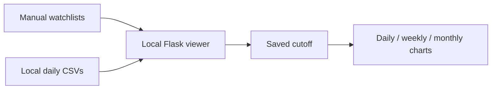

# StockView · Chart Review

**A local candlestick viewer for monthly watchlists.**

<sub>面向月度观察名单的本地 K 线查看器。</sub>


Review daily, weekly and monthly price charts from local CSV files. Watchlists are supplied manually, and each chart respects a saved historical cutoff. The included demo uses entirely fictional prices.

<sub>从本地 CSV 查看日、周、月 K 线；名单由用户手动提供，图表按保存的历史截止日截取。演示行情完全虚构。</sub>

The automated selection engine, proprietary rules, parameters, weights, research scripts and actual selection results are maintained separately in a **private repository**. This public project contains the presentation interface and generic data handling only. It does not connect to the private engine.

<sub>自动选股引擎、非公开规则、参数、权重、研究脚本和真实筛选结果均保存在独立的私有仓库。公开版仅包含展示界面和通用数据处理，不连接私有引擎。</sub>

## Features

- **Daily, weekly and monthly candles** with volume and interactive zoom. <br><sub>日／周／月 K 线、成交量及交互缩放。</sub>
- **Monthly manual watchlists** with a separate cutoff per symbol. <br><sub>按月份手动维护名单，并为每只股票保存历史截止日。</sub>
- **Local processing** with no market-data API key or external chart scripts. <br><sub>本地处理，无需行情 API 密钥，图表脚本随仓库提供。</sub>
- **English-first interface and documentation**, with smaller Chinese notes. <br><sub>界面及文档以英文为主，中文说明使用较小字号。</sub>

## Quick start

Use Python 3.11 or later. Run the following commands from a terminal. Initial dependency installation requires an internet connection; the fictional demo then runs locally.

<sub>需要 Python 3.11 或更高版本。首次安装依赖需要联网，之后虚构数据演示在本地运行。</sub>

```bash
git clone https://github.com/LarrryLiu/StockView.git
cd StockView
python3 -m venv .venv
source .venv/bin/activate
python -m pip install -r requirements.txt
python scripts/create_sample_data.py
python launch.py
```

Open **http://127.0.0.1:5051/** if the browser does not open automatically. Press `Ctrl+C` to stop. If port 5051 is already in use, close the other local viewer first.

<sub>浏览器未自动打开时，访问上面的本机地址；按 `Ctrl+C` 停止。端口已被占用时，先关闭其他本地查看器。</sub>

On Windows PowerShell, use `python` instead of `python3`, and activate the environment with `.\.venv\Scripts\Activate.ps1`.

<sub>Windows PowerShell 中将 `python3` 替换为 `python`，并使用上述 Windows 路径激活环境。本次未进行 Windows 实机验证。</sub>

## Your own watchlist

1. Place one CSV per symbol in `collected_stocks/`. See the [data format](docs/DATA_FORMAT.md).
2. Edit `picks.json` with the desired month, symbol, display name and cutoff.
3. Refresh the page. No screening or ranking is performed.

<sub>每只股票放一份 CSV，然后修改观察名单文件并刷新页面。公开版不进行自动筛选或排名。仓库忽略本地 CSV；也不要把私有策略的真实名单提交到公开仓库。</sub>

```json
{
  "2025-12": [
    {"symbol": "DEMO_A", "name": "Fictional Alpha", "cutoff": "2025-12-31"}
  ]
}
```



## Project layout

| Path | Purpose |
| --- | --- |
| `viewer.py` | CSV loading, cutoff handling and read-only chart endpoints. <br><sub>通用 CSV 加载、历史截取与只读图表接口。</sub> |
| `index.html`, `assets/` | Bilingual chart interface. <br><sub>双语图表界面。</sub> |
| `picks.json` | Manually supplied fictional watchlists. <br><sub>手动填写的虚构观察名单。</sub> |
| `scripts/create_sample_data.py` | Reproducible fictional OHLCV data. <br><sub>可重复生成的虚构行情。</sub> |
| `tests/` | Cutoff, aggregation, input and access checks. <br><sub>历史截取、周期聚合、输入及访问检查。</sub> |
| `vendor/` | Local chart library and original licenses. <br><sub>本地图表库及其原始许可证。</sub> |

## Development

```bash
python -m pip install -r requirements-dev.txt
python -m pytest -q
```

Local publication checks: **11 tests passed** on Python 3.12. An optional [GitHub Actions template](docs/ci-workflow.example.yml) is included for later setup. The application binds only to `127.0.0.1:5051`. Publishing the repository on GitHub shares the source code; it does not deploy a live website or expose the private strategy.

<sub>本次在 Python 3.12 上通过 11 项本地测试，并附带可选的自动测试配置模板。应用仅监听本机地址；上传到 GitHub 是托管源代码，不会自动部署在线网站，也不会开放私有策略。</sub>

## Credits and scope

Prepared with AI-assisted implementation. Local chart rendering uses TradingView Lightweight Charts; reference attribution is retained in [Third-party notices](THIRD_PARTY_NOTICES.md). The public viewer makes no investment-performance claim.

<sub>代码使用 AI 辅助实现，图表由 TradingView Lightweight Charts 提供；第三方声明保留参考来源。本查看器不作投资收益声明。</sub>

Original public viewer code is licensed under [MIT](LICENSE). Third-party components retain their original licenses. This license does not cover the separately maintained private strategy.

<sub>公开查看器代码采用 MIT 许可证，第三方组件保留原许可证；该许可不涉及独立维护的私有策略。</sub>
